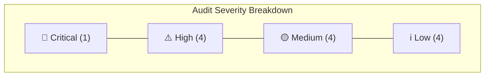

# 🔍 Ta3 (تعلّم) — Comprehensive System Audit & Weakness Report

**Date**: November 16, 2026  
**Auditor**: Antigravity Autonomous Swarm Protocol (ASP)  
**Scope**: Frontend architecture, React lifecycle rules, 3-Tier Security/RBAC, Persistence & Repository Decoupling, Database/Backend Readiness, and Concurrency Integrity.

---

## Executive Summary

The Ta3 (تعلّم) platform exhibits strong UX execution, rich domain features (Levant cashflow, audio-only 3G streaming, Skool-style community gamification, cohort calendars), and 100% passing tests (53 test files / 318 unit tests).

However, a comprehensive deep-dive static and architectural audit revealed **critical runtime hazards, security vulnerabilities, repository decoupling gaps, and unintegrated defense mechanisms** that must be addressed before production deployment.



---

## 🚨 1. Critical Weaknesses (Immediate Runtime / Crash Hazards)

### 1.1. React Hook Lifecycle Violations (Rules of Hooks Breach)
- **Files**:
  - [`src/components/profile/UserProfileModal.tsx#L66-L128`](file:///c:/Users/hadev/OneDrive%20-%20Aarhus%20universitet/Dokumenter/GitHub/ta3/src/components/profile/UserProfileModal.tsx#L66-L128)
  - [`src/pages/profile/UserProfilePage.tsx#L62-L126`](file:///c:/Users/hadev/OneDrive%20-%20Aarhus%20universitet/Dokumenter/GitHub/ta3/src/pages/profile/UserProfilePage.tsx#L62-L126)
- **Issue**: Both components execute an early return before invoking a React hook:
  ```tsx
  // UserProfileModal.tsx:66
  if (!user) return null; // ❌ Early return before hooks!
  ...
  // UserProfileModal.tsx:128
  const fileInputRef = useRef<HTMLInputElement>(null); // 💥 ESLint: react-hooks/rules-of-hooks
  ```
- **Risk**: Violates React's invariant that hooks must execute in the exact same sequence across every render. If `user` transitions between `null` and defined during session changes or hot reload, React will throw an unhandled internal fiber exception (`Rendered fewer hooks than expected`), crashing the UI.
- **Fix**: Move `const fileInputRef = useRef<HTMLInputElement>(null);` to the top of the component alongside other `useState` declarations before any conditional `if (!user) return null;`.

---

## ⚠️ 2. High-Risk Security & Access Control Weaknesses

### 2.1. Client-Side Role Tampering via `localStorage`
- **File**: [`src/lib/MockAuthEngine.ts#L204-L210`](file:///c:/Users/hadev/OneDrive%20-%20Aarhus%20universitet/Dokumenter/GitHub/ta3/src/lib/MockAuthEngine.ts#L204-L210)
- **Issue**: The active user session is parsed directly from unencrypted, unsigned `localStorage`:
  ```ts
  const raw = localStorage.getItem('ta3_user');
  const parsed = JSON.parse(raw);
  if (parsed && typeof parsed === 'object' && parsed.role) return parsed as User;
  ```
- **Vulnerability**: Any student user can open Chrome DevTools, run:
  ```js
  const u = JSON.parse(localStorage.getItem('ta3_user'));
  u.role = 'admin';
  localStorage.setItem('ta3_user', JSON.stringify(u));
  location.reload();
  ```
  Because `RequireAuth.tsx` checks `user.role` from `AuthContext`, the user is immediately granted unrestricted access to the SuperAdmin dashboard, registered student records, and financial payout consoles.
- **Remediation**:
  1. For production: Rely strictly on validated Supabase JWT tokens via `supabase.auth.getSession()` where role is extracted from a cryptographically signed JWT claim (`jwt.app_metadata.role`).
  2. For offline/mock mode: Add HMAC-SHA256 signature validation or cryptographic hash tag in `localStorage` to reject client-side JSON tampering.

### 2.2. Hardcoded Credentials & Universal Passwords
- **Files**:
  - [`src/lib/MockAuthEngine.ts#L253`](file:///c:/Users/hadev/OneDrive%20-%20Aarhus%20universitet/Dokumenter/GitHub/ta3/src/lib/MockAuthEngine.ts#L253)
  - [`src/contexts/AuthContext.tsx#L71`](file:///c:/Users/hadev/OneDrive%20-%20Aarhus%20universitet/Dokumenter/GitHub/ta3/src/contexts/AuthContext.tsx#L71)
- **Issue**: `password: password || '123'`. Every mock account (`student`, `teacher`, `creator`, `admin`) accepts the password `'123'`.
- **Remediation**: Before any production pilot, disable the mock credential bypass when `import.meta.env.PROD === true`.

### 2.3. Hidden vs Protected Registration
- **Files**:
  - [`src/pages/Login.tsx#L16`](file:///c:/Users/hadev/OneDrive%20-%20Aarhus%20universitet/Dokumenter/GitHub/ta3/src/pages/Login.tsx#L16)
  - [`src/contexts/AuthContext.tsx#L103`](file:///c:/Users/hadev/OneDrive%20-%20Aarhus%20universitet/Dokumenter/GitHub/ta3/src/contexts/AuthContext.tsx#L103)
- **Issue**: Registration is concealed in the UI with `ENABLE_REGISTRATION = false`, but the backend fallback `register(...)` function in `AuthContext.tsx` is completely exposed. Any caller can execute `register(email, password, name, 'admin')` and create a local SuperAdmin user without restriction.
- **Remediation**: Ensure `register()` rejects role specification other than `student`, or enforces `if (!ENABLE_REGISTRATION) throw new Error(...)` at the context tier.

### 2.4. Regex Control Characters in Content Sanitizer
- **File**: [`src/lib/security/contentSanitizer.ts#L51`](file:///c:/Users/hadev/OneDrive%20-%20Aarhus%20universitet/Dokumenter/GitHub/ta3/src/lib/security/contentSanitizer.ts#L51)
- **Issue**: ESLint flagged: `Unexpected control character(s) in regular expression: \x00, \x1f (no-control-regex)`.
- **Risk**: Inconsistent regex engine parsing across mobile Safari vs Chrome can cause regex compilation errors or bypasses in input sanitization.

---

## 🟡 3. Medium Architectural & Decoupling Inconsistencies

### 3.1. Partial Repository Decoupling (Direct Mock Imports)
- **Files**:
  - [`src/contexts/CourseContext.tsx#L3`](file:///c:/Users/hadev/OneDrive%20-%20Aarhus%20universitet/Dokumenter/GitHub/ta3/src/contexts/CourseContext.tsx#L3)
  - [`src/components/admin/PaymentVerificationQueue.tsx#L28`](file:///c:/Users/hadev/OneDrive%20-%20Aarhus%20universitet/Dokumenter/GitHub/ta3/src/components/admin/PaymentVerificationQueue.tsx#L28)
  - [`src/components/marketplace/CheckoutDialog.tsx#L28`](file:///c:/Users/hadev/OneDrive%20-%20Aarhus%20universitet/Dokumenter/GitHub/ta3/src/components/marketplace/CheckoutDialog.tsx#L28)
- **Issue**: Although `src/types/repository.ts` and `repositoryRegistry` were implemented, these UI components still import `MockDataEngine` and `ReceiptStore` directly instead of consuming `repositoryRegistry.getCourseRepository()` and `repositoryRegistry.getReceiptRepository()`.
- **Impact**: Swapping to a remote Supabase PostgREST repository at runtime will not reflect in `CourseContext` or `PaymentVerificationQueue` until they are refactored to consume the registry getter.

### 3.2. OCC (Optimistic Concurrency Control) Not Wired to UI Forms
- **File**: [`src/lib/occ.ts`](file:///c:/Users/hadev/OneDrive%20-%20Aarhus%20universitet/Dokumenter/GitHub/ta3/src/lib/occ.ts)
- **Issue**: `occManager` has unit tests for version validation and multi-client collision simulations, but no form handlers in the UI (e.g. `GradingConsole.tsx`, `LectureDialog.tsx`, `AnnouncementDialog.tsx`) actually pass version tags or invoke `occManager.validateAndIncrement()`.
- **Impact**: Two teachers concurrently modifying the same lecture or assignment in separate browser tabs will silently overwrite each other's changes.

### 3.3. PostgREST Error Boundary Not Wired to Client Interceptors
- **File**: [`src/lib/network/postgrestErrorHandler.ts`](file:///c:/Users/hadev/OneDrive%20-%20Aarhus%20universitet/Dokumenter/GitHub/ta3/src/lib/network/postgrestErrorHandler.ts)
- **Issue**: `PostgrestErrorHandler` is thoroughly tested in isolation, but neither `src/lib/supabase.ts` nor React Query hooks (`queryClient`) route unexpected network/API errors through `PostgrestErrorHandler.handle(error)`.
- **Impact**: Real 401, 403, or 409 errors from PostgREST will result in generic unhandled promise rejections or raw toast errors rather than Arabic user-friendly resilience actions.

### 3.4. Production Bundle Size & Monolithic Chunks
- **Files**: `vite.config.ts`, `dist/assets/index-*.js` (533 kB minified, 161 kB gzip)
- **Issue**: Vite warns that chunks exceed 500 kB. Large icons (`lucide-react`) and full icon libraries are bundled together with vendor libraries.
- **Impact**: Increased Initial Load Time (LCP) on 3G Levant mobile connections.
- **Remediation**: Configure `build.rollupOptions.output.manualChunks` in `vite.config.ts` to separate vendor dependencies (`react`, `react-dom`, `lucide-react`, `@tanstack/react-query`) into independent chunks.

---

## ℹ️ 4. Low-Severity & Maintenance Debt

1. **Empty Directories**: `backend/` and `ai-service/` folders exist as empty directories in the repository root.
2. **Missing `useEffect` Dependency**:
   - [`src/pages/courses/Groups.tsx#L129`](file:///c:/Users/hadev/OneDrive%20-%20Aarhus%20universitet/Dokumenter/GitHub/ta3/src/pages/courses/Groups.tsx#L129): `useEffect` has missing dependency `defaultCourseLimit`.
3. **TypeScript `any` Types in Utilities**:
   - 56 ESLint `@typescript-eslint/no-explicit-any` warnings across `commandBus.ts`, `idempotency.ts`, `optimistic.ts`, and `redisCache.ts`.
4. **Vite Deprecation Warning**:
   - `vite.config.ts`: `__dirname` is deprecated in ESM (`import.meta.dirname` should be used), and `optimizeDeps.esbuildOptions` is deprecated in Vite 5.

---

## 🛠️ Prioritized Action Plan

| Priority | Task | Target Files |
|---|---|---|
| **P0** | Fix React Hook conditional calls before early return | `UserProfileModal.tsx`, `UserProfilePage.tsx` |
| **P1** | Wire `repositoryRegistry` to `CourseContext`, `PaymentVerificationQueue`, and `CheckoutDialog` | `CourseContext.tsx`, `PaymentVerificationQueue.tsx`, `CheckoutDialog.tsx` |
| **P2** | Integrate `PostgrestErrorHandler` into global React Query & Supabase interceptor | `src/App.tsx`, `src/lib/supabase.ts` |
| **P3** | Wire `occManager` version check to course and grading mutations | `GradingConsole.tsx`, `CourseContext.tsx` |
| **P4** | Code-split vendor chunks in `vite.config.ts` to reduce initial bundle < 350 kB | `vite.config.ts` |
| **P5** | Clean up ESLint warnings & fix regex control characters | `contentSanitizer.ts`, `Groups.tsx`, `Day3ArchitectureCQRS.test.ts` |
